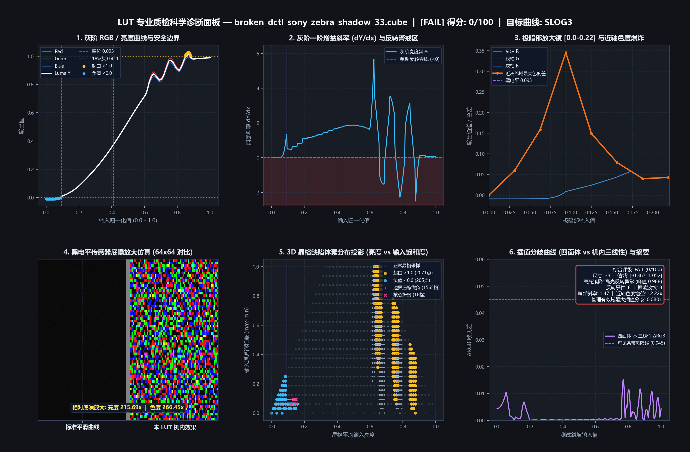
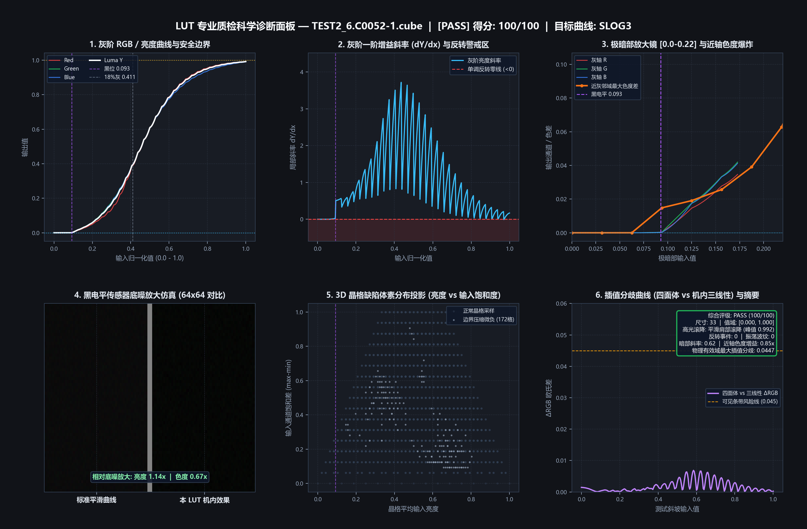
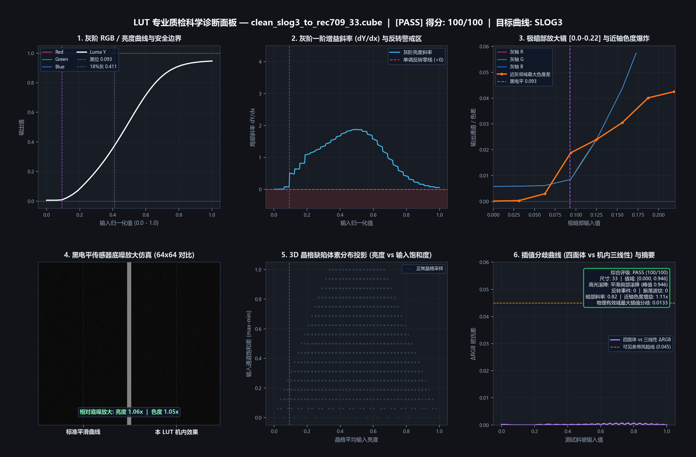
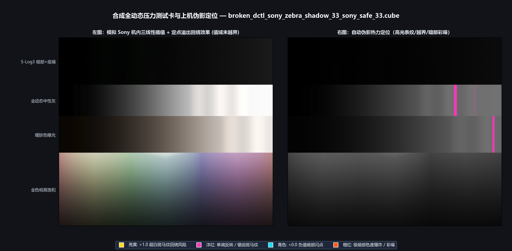
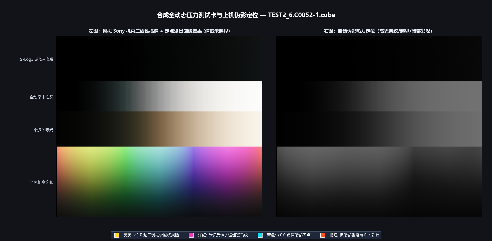
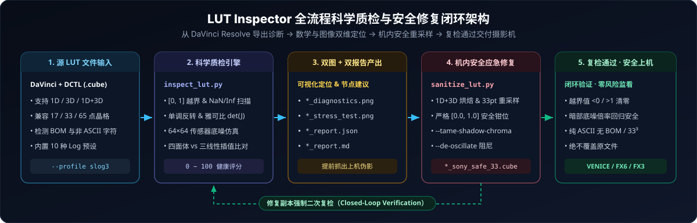
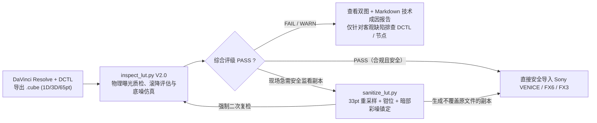

<div align="center">


<br />

[](#v20-核心工程能力升级)
[](requirements.txt)
[](#为什么需要-lut-inspector)
[](#sony-venice--fx6--fx3-导出避坑-5-秒自查)
[](#命令行独立运行)
[](LICENSE)

<p align="center">
  <strong>专为 DaVinci Resolve + 第三方 DCTL 与 Sony VENICE / FX6 / FX3 机内监看打造的 3D LUT 客观工程质检与安全修复 Skill</strong><br />
  场景线性物理曝光扫描 · 高光滚降 vs 宽色域投影精准区分 · S-Log3 黑位底噪仿真 · 6 宫格科学诊断图 + 压力热力图 · 一键 33 点安全重采样
</p>

[痛点解析](#为什么需要-lut-inspector) ·
[原理可视化](#底层原理可视化) ·
[图表与实测对比](#实测诊断图表详解) ·
[架构与工作流](#架构与闭环工作流) ·
[快速开始](#安装与快速开始) ·
[Log 曲线预设](#支持的-log-曲线与目标环境) ·
[导出避坑自查](#sony-venice--fx6--fx3-导出避坑-5-秒自查)

</div>

---


很多调色师和 DIT 都遇过同一个现场噩梦：**LUT 在 DaVinci Resolve 监视器里完美无瑕，一导进 Sony VENICE / FX6 / FX3 机内监看，高光就出现类似斑马纹的黑白/补色条纹，极暗部更是炸满蠕动彩噪。**

根源在于 **Resolve 32-bit 浮点视口** 与 **摄影机机内定点 FPGA 管线** 存在巨大硬件差异：

| 现场常见伪影 | DaVinci Resolve 32-bit 浮点视口 | Sony 机内定点 FPGA / ASIC 硬件 | `lut-inspector` V2.0 工程拦截手段 |
| :--- | :--- | :--- | :--- |
| **高光类似“斑马纹”条纹** | `> 1.0` 超白值被视口自然裁切为纯白，肉眼完全察觉不到异常 | 浮点 `1.05` 在无符号定点管线发生 **溢出回绕 (Wrap-around)** 跌成 `0.05` 纯黑条带 | 全晶格扫描 `> 1.0` 越界比例与坐标，并在压力测试卡左图直观复现溢出回绕带 |
| **渐变等高线 / 反相条带** | 局部极高对比或锐度在静态画面中不易察觉 | **单调性反转 (`dY/dx < 0`)** 与 **高频锯齿振荡** 导致平滑渐变裂出明暗交替条纹 | 基于 **场景线性相机曝光扫描 (`-7.0 EV ~ +6.5 EV`)** 测算亮度导数与锯齿翻转，杜绝 Log 假误报 |
| **高光硬削波 vs 宽色域映射** | 宽色域（如 `S-Gamut3.Cine`）转 `Rec.709` 时大量边缘色被压缩至色域壁 | 仅单通道触及 `1.0` 是正常的色域投影，而三通道全白平顶才是真正的无滚降死白硬削波 | `check_highlight_rolloff` 拆解中性灰肩部斜率衰减、`achromatic_white_clip_pct` 与 `gamut_wall_projection_pct` |
| **网状撕裂 / 阶梯断层** | 默认 **Tetrahedral（四面体）插值** 平滑过渡掩盖局部折叠 | 机内常用 **Trilinear（三线性）插值**，且 **核心有效色域雅可比 `det(J) < 0`** 会使插值路径折返 | 区分「核心有效区折叠」与「超色域边界压缩」，计算物理有效色域四面体 vs 三线性 `ΔRGB` 分歧 |
| **极暗部颗粒 / 蠕动彩噪** | 16/32-bit 下微弱黑位偏差不易放大 | S-Log3 0% 黑位 (`95/1023 ≈ 0.0929`) 紧贴 33 点第 3 层，DCTL 除零 (`1/(L+ε)`) 与 `< 0.0` 下溢引发彩噪爆发 | 紧盯黑电平邻域测算近灰轴色度增益，并运行 **64×64 传感器底噪蒙特卡洛仿真** |
| **摄影机拒载 / 曲线错位** | Resolve 内不校验文件头规范 | 65 点体积、1D+3D Shaper、非 `[0,1]` Domain、UTF-8 BOM 或中文 `TITLE` 均会导致读卡失败 | 强制检查硬件规格头信息；`sanitize_lut.py` 自动烘焙、33 点四面体重采样并输出纯 ASCII 无 BOM |

### V2.0 核心工程能力升级

- **全 10 种色彩空间双向物理变换**：为 `slog3 / logc3 / logc4 / vlog / log3g10 / clog3 / davinci_intermediate / acescct / rec709 / generic_log` 建立双向对数与色域矩阵转换，所有斜坡、压力卡与体素检验严格锚定物理有效拍摄色域。
- **专职高光肩部滚降定性 (`check_highlight_rolloff`)**：明确区分 `SMOOTH_ROLLOFF`（平滑肩部滚降）、`HARD_CLIP_NO_ROLLOFF`（硬削波无滚降）与 `NON_MONOTONIC_HIGHLIGHT`（高光反转），彻底消除把宽色域外壁单通道压缩误判为“无滚降”的误报。
- **客观工程质检护栏 ([`SKILL.md`](skills/lut-inspector/SKILL.md))**：严格界定 AI 仅做客观数学与机内安全质检，**禁止对调色师创意 Look（如 18% 灰亮暗偏好、胶片柔白峰值、饱和度风格）指手画脚或越界“教调色”**。

---

## 底层原理可视化

<div align="center">
  
</div>

### Sony S-Log3 10-bit 关键锚点与 33 点晶格映射关系

在 10-bit Data Range (`0 ~ 1023`) 映射至 `[0.0, 1.0]` 时，Sony S-Log3 的黑电平与 33 点 3D LUT 晶格节点存在物理级贴合：

| 物理意义 | 场景反射率 | 10-bit 码值 (`0–1023`) | 归一化输入 (`0.0–1.0`) | 对应 33 点晶格层 (`i / 32`) | 常见风险说明 |
| :--- | :---: | :---: | :---: | :---: | :--- |
| **Sub-Black（超黑/热噪区）** | `< 0%` | `< 95` | `< 0.092864` | 第 `0, 1, 2` 层 (`0.000, 0.03125, 0.06250`) | 色域矩阵或负 Lift 产生 `< 0.0` 负值，机内下溢成高亮闪点 |
| **0% Black（物理黑电平）** | `0%` | **`95`** | **`0.092864`** | **紧贴第 `3` 层 (`3/32 = 0.09375`)** | 传感器暗电流热噪以 `0.0929` 为中心抖动，极易撞击 DCTL 除零奇异点 |
| **暗部阴影关键带** | `~2% – 5%` | `140 – 220` | `0.137 – 0.215` | 第 `4 ~ 7` 层 | 过陡 TOE 对比度或重复挂两层 Log→709 会令亮度噪点放大数十倍 |
| **18% 中灰 (Mid Gray)** | `18%` | **`420`** | **`0.410557`** | 第 `13` 层 (`0.40625`) | 决定整体曝光归位基准 |
| **90% 白 (Diffuse White)** | `90%` | **`598`** | **`0.584555`** | 第 `19` 层 (`0.59375`) | 之上至 `1.0` 为高光滚降区，DCTL 最易超 `1.0` 或发生单调反转 |

---

## 实测诊断图表详解

仓库内置 [`generate_test_luts.py`](skills/lut-inspector/scripts/generate_test_luts.py) 与 V2.0 全套自检报告示例（位于 [`examples/sample_report/`](examples/sample_report/) 与 [`examples/test2_report/`](examples/test2_report/)），下面展示 **健康基准 LUT**、**真实 Resolve CST+ODT 实战 LUT (`TEST2_6.C0052-1.cube`)**、**典型缺陷 DCTL LUT** 与 **应急修复版 LUT** 的真实运行对照。

### 四组实测样本量化指标对比

| 检验维度 | 健康基准 `clean_slog3...33` | 真实调色样片 `TEST2_6.C0052-1` | 故障 DCTL `broken_dctl...33` | 应急修复版 `..._sony_safe_33` | 工程安全基准 |
| :--- | :---: | :---: | :---: | :---: | :---: |
| **综合评级与健康分** | `PASS` (**100 / 100**) | `PASS` (**100 / 100**) | `FAIL` (**0 / 100** · 7 严重 2 警告) | `FAIL` (**0 / 100** · 5 严重 1 警告)* | `PASS` |
| **值域范围 (`min ~ max`)** | `7.4e-05 ~ 0.946347` | `0.0 ~ 1.0` | `-0.366533 ~ 1.051691` | **`0.0 ~ 1.0`** | 严格 `[0.0, 1.0]` |
| **越界比例 (`<0.0` / `>1.0`)** | `0.0%` / `0.0%` | `0.0%` / `0.0%` | `0.37%` / `2.482%` | **`0.0%` / `0.0%`** | `0.0%` / `0.0%` |
| **高光滚降状态 / 末端斜率** | `SMOOTH_ROLLOFF` (`0.101`) | `SMOOTH_ROLLOFF` (`0.147`) | `NON_MONOTONIC_HIGHLIGHT` (`-0.047`) | `NON_MONOTONIC_HIGHLIGHT` (`-0.01`) | 平滑衰减 (`< 0.45`) |
| **死白削波 vs 色域壁投影** | `0.0%` / `0.0%` | **`0.0%` / `60.61%`** | `0.16%` / `5.73%` | `0.03%` / `4.7%` | 死白近 `0%` |
| **物理曝光反转 / 振荡波纹** | `0` / `0` | **`0` / `0`** | `8` / `8` | `8` / `8` | `0` / `0` |
| **三维折叠 (核心区 / 边界)** | `0` / `0` | **`0` / `172`** | `16` / `1565` (`min_core=-4.6248`) | `13` / `1437` (`min_core=-0.3203`) | 核心区 `0` 格 |
| **近灰轴色度爆炸 (增益 / 格数)** | `1.115x` (`0` 格) | `0.855x` (`0` 格) | `12.22x` (`42` 格) | **`3.457x` (`2` 格)** | `< 3.0x` (`0` 格) |
| **64×64 底噪放大 (亮度 / 色度)** | `1.06x` / `1.05x` | `1.14x` / `0.67x` | `215.69x` / `266.45x` | **`4.09x` / `4.05x`** | `< 2.2x` / `< 2.4x` |
| **物理有效区插值分歧 `ΔRGB`** | `0.01329` | `0.04473` | `0.0801` | **`0.03444`** | `< 0.065` |
| **晶格最大邻域跃迁 `ΔRGB`** | `0.1871` | `0.2591` | `0.5593` | **`0.2267`** | `< 0.45` |

> \* 注：故障示例刻意注入了大幅高光正弦波纹与大曲率通道反转；`sanitize_lut.py` 一键清零了全部 `<0.0 / >1.0` 越界闪点并将极暗部底噪由 **266.45x** 压降 65 倍至 **4.05x**，而剧烈的结构性 Solarization 仍需按报告提示回到 DaVinci Resolve 中调低对应 DCTL 参数以从源头消除。
>
> 💡 **实战看点 (`TEST2_6.C0052-1.cube`)**：该真实 Resolve + ODT 样片有 `60.61%` 的格点单通道触及 `1.0`（位于目标 Rec.709 广色域外部的正常色域壁映射），且在超色域压缩壁存在 `172` 个边界体素折叠——V2.0 引擎精准识别出其 **三通道死白削波为 `0.0%`、核心有效拍摄区折叠为 `0`、肩部斜率由 `3.72` 平滑滚降至 `0.15`（峰值 `0.9923`）**，给出 **`PASS 100/100`** 客观结论！

---

### 1. 6 宫格科学诊断面板 (`*_diagnostics.png`)

<table>
  <tr>
    <th width="50%">🔴 故障 DCTL LUT（FAIL · 0/100）</th>
    <th width="50%">🟢 真实 Resolve 调色样片 TEST2_6（PASS · 100/100）</th>
  </tr>
  <tr>
    <td></td>
    <td></td>
  </tr>
</table>

<details>
<summary><strong>📖 点击展开：对比健康基准样本 clean_slog3_to_rec709_33 & 6 宫格各子图导读</strong></summary>

<p align="center">
  
</p>

1. **灰阶 RGB / 亮度曲线与安全边界**：叠加黑位 (`0.093`) 与 18% 灰 (`0.411`) 竖线；**黄点**标出 `>1.0` 超白，**蓝点**标出 `<0.0` 负值，并可直观观测肩部向 `1.0` 收敛的平滑滚降姿态。
2. **灰阶一阶增益斜率 (`dY/dx`) 与反转警戒区**：曲线一旦跌入下方红色 `< 0` 区域即发生 **单调性反转**，剧烈尖峰震荡则对应高频斑马条纹；健康 LUT 的肩部斜率在中灰之后稳定逐级衰减至接近 0。
3. **极暗部放大镜 `[0.0–0.22]` 与近轴色度爆炸**：紧盯 S-Log3 黑位 `0.093` 附近的橙色色差曲线；若在此处猛烈冲高，代表存在 DCTL 除零彩噪缺陷。
4. **黑电平传感器底噪放大仿真 (`64×64` 对比)**：左侧为标准平滑曲线在底噪下的黑场，右侧为当前 LUT 模拟机内效果，直观暴露“彩噪马赛克”。
5. **3D 晶格缺陷体素分布投影（亮度 vs 输入饱和度）**：在亮度–饱和度二维投影上明确区分超白 (`>1.0`)、负值 (`<0.0`)、**边界压缩微负** 与 **核心折叠 (`×` 号)**，避免将广色域外压缩体素误认为核心崩溃。
6. **插值分歧曲线（四面体 vs 机内三线性）与摘要**：紫色曲线对比 `0.045` 可见条带风险线；右上角摘要框汇总评级、高光滚降定性、反转事件、暗部斜率/色度及物理有效域最大插值分歧。

</details>

---

### 2. 合成全动态压力测试卡 & 伪影热力定位图 (`*_stress_test.png`)

左图直接模拟 **Sony 机内三线性插值 + 定点溢出回绕** 的实际成像，右图基于 **场景线性物理曝光斜坡** 自动按颜色高亮定位伪影区域（图例：**亮黄** `>1.0` 超白回绕 · **洋红** 单调反转/锯齿斑马纹 · **青色** `<0.0` 负值闪点 · **橙红** 极暗部色度爆炸彩噪）：

<details open>
<summary><strong>🔴 故障 DCTL 修复前：暗部满屏彩噪闪点 + 高光/肤色溢出色带</strong></summary>

</details>

<details>
<summary><strong>🛠️ 经 sanitize_lut.py 应急修复后：暗部彩噪块与溢出黄青条带已清零，仅留源头高光反转带</strong></summary>

</details>

<details>
<summary><strong>🟢 真实 Resolve 样片 TEST2_6.C0052-1：暗部纯净、高光平滑滚降、全色相热力图零伪影</strong></summary>

</details>

<details>
<summary><strong>🟢 健康基准 clean_slog3_to_rec709_33：S-Log3 暗部纯净、全动态中性灰与暖肤色平滑连续</strong></summary>

</details>

---

## 架构与闭环工作流

<div align="center">
  
</div>



---

## 安装与快速开始

### 环境依赖

仅需 **Python 3.10+** 与三个常见基础库（无需 `scipy`）：

```powershell
git clone https://github.com/VINK77aaaa/lut-inspector-skill.git
cd lut-inspector-skill
pip install -r requirements.txt
```

> [!TIP]
> **Windows 用户提示**：若系统中 `python` 指向 Microsoft Store 占位符，请统一使用 `py` 命令运行脚本。

---

### 方式一：作为 Antigravity / WorkBuddy / AI Agent Skill 使用

本仓库根目录已配置 [`.agents/skills.json`](.agents/skills.json)，且核心技能包位于 [`skills/lut-inspector/`](skills/lut-inspector/)（内部自包含 [`requirements.txt`](skills/lut-inspector/requirements.txt) 以便独立分发）。

- **当前工作区直接使用**：在工作区中打开 AI 对话，直接发送 `.cube` 文件路径即可自动触发 [`SKILL.md`](skills/lut-inspector/SKILL.md) V2.0 标准 SOP（包含防误判与禁“教调色”护栏）。
- **全局安装到任意项目可用**：将 [`skills/lut-inspector/`](skills/lut-inspector/) 复制到全局技能目录：
  - Antigravity：`~/.gemini/config/skills/lut-inspector/`（Windows 为 `%USERPROFILE%\.gemini\config\skills\lut-inspector\`）
  - WorkBuddy：`~/.workbuddy-ai/skills/lut-inspector/`（Windows 为 `%USERPROFILE%\.workbuddy-ai\skills\lut-inspector\`）

示例自然语言指令：
- *“帮我用 lut-inspector 检查这个准备放进索尼 FX6 的 LUT：`D:/LUTs/MyFilmLook.cube`”*
- *“导出的 S-Log3 LUT 在威尼斯机内高光像有斑马纹，暗部噪点也炸了，帮我诊断原因并出一个安全修复版。”*

---

### 方式二：命令行独立运行

#### 1. 深度质检并生成双图与双报告
```powershell
py skills/lut-inspector/scripts/inspect_lut.py "examples/broken_dctl_sony_zebra_shadow_33.cube" --profile slog3 --target sony_cinealta --out-dir "./report_out"
```
常用参数说明：
- `--profile`：输入素材对应的 Log 曲线预设（默认 `slog3`，详见下方支持列表）
- `--target`：目标运行环境（`sony_cinealta` 默认 / `generic_camera` / `post`）
- `--out-dir`：输出 JSON、Markdown、6 宫格诊断图与压力测试图的目录
- `--no-plots`：跳过生成 PNG 图表（适合纯 CI 快速体检）
- `--strict-exit`：若评级为 `FAIL` 则返回退出码 `2`

#### 2. 生成 Sony 机内安全修复版副本（绝不覆盖原文件）
```powershell
py skills/lut-inspector/scripts/sanitize_lut.py "examples/broken_dctl_sony_zebra_shadow_33.cube" --size 33 --profile slog3 --clamp --fix-nan --tame-shadow-chroma --de-oscillate
```
核心修复开关：
- `--size`：输出 3D 晶格尺寸（`17` / `33` / `65` / `keep`，Sony 机内推荐默认 `33`；会自动烘焙合并 1D+3D Shaper）
- `--clamp` / `--fix-nan`：默认开启，执行 `[0.0, 1.0]` 严格钳位与 `NaN`/`Inf` 邻域插补
- `--tame-shadow-chroma`：针对 S-Log3 黑位附近近灰轴色度爆炸做保亮度限幅（有效消除暗部蠕动彩噪）
- `--de-oscillate`：开启保边去振荡阻尼，缓解高光高频锯齿斑马纹
- 输出默认保存为同目录 `*_sony_safe_33.cube`（纯 ASCII、无 BOM、LF 换行、标准 R-fastest 排序）。**修复后请务必再次运行 `inspect_lut.py` 完成复检闭环。**

#### 3. 生成本地回归测试样本
```powershell
py skills/lut-inspector/scripts/generate_test_luts.py --out-dir "./examples"
```

---

## 支持的 Log 曲线与目标环境

[`inspect_lut.py`](skills/lut-inspector/scripts/inspect_lut.py) 内置 **10 种摄影机/色彩空间曲线预设**（均配备双向对数转换与原生色域矩阵）及 **3 种硬件目标环境**：

| `--profile` 参数值 | 适用色彩空间 / 摄影机曲线 | 0% 黑电平参考 | 18% 中灰参考 |
| :--- | :--- | :---: | :---: |
| `slog3` *(默认)* | Sony S-Log3 / S-Gamut3.Cine (VENICE / FX6 / FX3) | `0.092864` (`95/1023`) | `0.410557` (`420/1023`) |
| `logc3` | ARRI LogC3 (EI800) | `0.092864` | `0.391007` |
| `logc4` | ARRI LogC4 (ALEXA 35) | `0.092864` | `0.278395` |
| `vlog` | Panasonic V-Log | `0.125122` (`128/1023`) | `0.423265` (`433/1023`) |
| `log3g10` | RED Log3G10 | `0.000000` | `0.333333` |
| `clog3` | Canon Log 3 | `0.125122` (`128/1023`) | `0.343300` |
| `davinci_intermediate` | DaVinci Intermediate | `0.000000` | `0.336043` |
| `acescct` | ACEScct | `0.072905` | `0.413588` |
| `rec709` | Rec.709 / Gamma 2.4 | `0.000000` | `0.409000` |
| `generic_log` | 通用摄影机 Log 预设 | `0.090000` | `0.400000` |

目标环境 (`--target`)：`sony_cinealta`（VENICE / FX6 / FX3 严格 33 点纯 3D 规范）· `generic_camera`（Atomos / SmallHD 等通用监视器）· `post`（仅后期 DaVinci 内部使用）。

---

## Sony VENICE / FX6 / FX3 导出避坑 5 秒自查

1. **尺寸**：必须导出 **`33 Point Cube`**（不要选 65 点或 1D+3D Shaper 复合格式）。
2. **节点禁区**：导出前务必关闭胶片颗粒（Grain）、光晕（Halation）、柔光（Glow）、暗角（Vignette）和任何空间滤镜。
3. **DCTL 开关**：确认关闭插件里的 `False Color / Zebra / Gamut Warning / Split View`。
4. **Data Levels**：遵循 S-Log3 完整 Full/Data 范围（`95/1023` 黑位对应 `0.092864`），避免套用错位的 Video Levels 压缩。
5. **编码命名**：文件名与内部 `TITLE` 使用纯英文、数字和下划线，避免中文字符或 UTF-8 BOM。

> 📚 深入技术原理与 DaVinci 节点修复指南，请参阅：
> - [Sony 机内规格与 S-Log3 黑位锚点技术指南](skills/lut-inspector/references/sony_cinealta_lut_guide.md)
> - [DaVinci Resolve 第三方 DCTL 常见伪影代码级与节点级排查手册](skills/lut-inspector/references/dctl_artifact_root_causes.md)

---

## 项目目录结构

```text
lut-inspector-skill/
├── .agents/
│   └── skills.json                         # Agent Skill 自动发现配置
├── assets/
│   ├── banner.svg                          # 项目主视觉 Banner
│   ├── slog3_anchor_and_artifacts.svg      # 溢出回绕与 S-Log3 黑位共振机制图
│   └── architecture_workflow.svg           # 全流程科学质检与闭环修复架构图
├── skills/lut-inspector/                   # 核心 Skill 包（可独立复制到全局目录）
│   ├── SKILL.md                            # V2.0 Agent 自动化执行标准 SOP 与强护栏规范
│   ├── requirements.txt                    # Skill 独立依赖清单 (numpy, matplotlib, Pillow)
│   ├── scripts/
│   │   ├── inspect_lut.py                  # V2.0 物理质检、高光滚降、底噪仿真与双图生成
│   │   ├── sanitize_lut.py                 # 机内安全修复、33 点重采样与彩噪镇定
│   │   └── generate_test_luts.py           # 标准正例与缺陷复现测试 LUT 生成器
│   └── references/
│       ├── sony_cinealta_lut_guide.md      # Sony VENICE / FX6 / FX3 技术规范
│       └── dctl_artifact_root_causes.md    # DCTL 伪影代码级与节点级排查手册
├── examples/
│   ├── clean_slog3_to_rec709_33.cube       # 健康 S-Log3 → Rec.709 基准样本
│   ├── broken_dctl_sony_zebra_shadow_33.cube              # 故障 DCTL 复现样本
│   ├── broken_dctl_sony_zebra_shadow_33_sony_safe_33.cube # 应急修复版样本
│   ├── sample_report/                      # 测试集 V2.0 JSON / Markdown / 双图示例报告
│   └── test2_report/                       # 真实 Resolve CST+ODT 样片 TEST2_6.C0052-1 报告
├── requirements.txt                        # 仓库根目录 Python 依赖
├── LICENSE                                 # MIT License
└── README.md                               # 本项目说明文档
```

## License

本项目基于 [MIT License](LICENSE) 开源。
